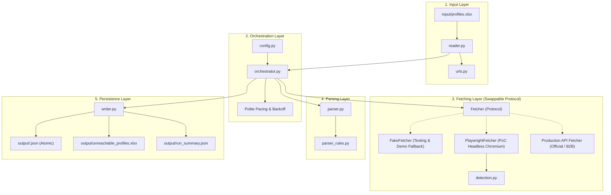
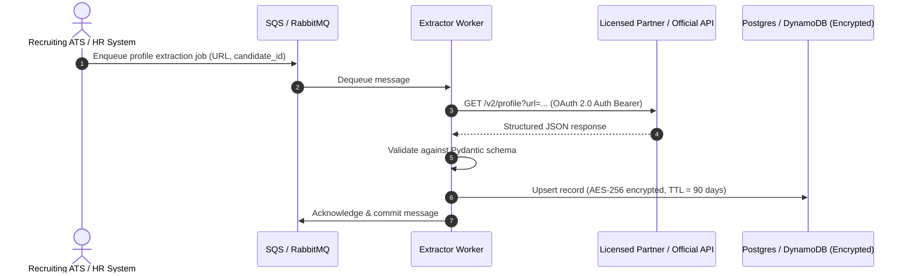

# Architecture & Design Specification

## System Overview

The **LinkedIn Profile Extractor** is built around clean boundaries, explicit data contracts, and dependency inversion to decouple pipeline orchestration from network fetching.

---

## Component Architecture

---

## Component Responsibilities ("Does and Does Not Do")

| Component | What It DOES | What It DOES NOT Do |
| :--- | :--- | :--- |
| **Input Reader** (`reader.py`, `urls.py`) | Reads Excel sheets; normalizes profile URLs to canonical `/in/<slug>/`; sanitizes slugs; filters blank rows; dedupes repeated links. | Does not make network requests; does not decide how to handle failed rows. |
| **Fetcher Protocol** (`fetcher/`) | Defines `fetch(url) -> FetchResult` interface; isolates implementation details (Playwright vs. API vs. Fake). | Does not parse DOM structure; does not write files or track counts. |
| **Detection Engine** (`detection.py`) | Inspects URLs and page content for authwalls (`not_visible`), missing profiles (`not_found`), or security challenges (`blocked`). | Does not retry or attempt to bypass security challenges. |
| **Parser** (`parser.py`, `parser_rules.py`) | Extracts structured fields from HTML; compiles unmapped sections into `other_sections`; computes missing fields. | Does not make network calls; does not write to disk. |
| **Writer** (`writer.py`) | Atomically writes JSON files; produces unreachable Excel report; outputs summary statistics; cleans temporary files. | Does not make business logic or validation decisions. |
| **Orchestrator** (`orchestrator.py`) | Drives row processing; enforces polite random delays; isolates per-row exceptions; halts on block; tallies complete metrics. | Does not contain HTML parsing logic or fetch transport details. |

---

## Risk Register & Mitigation Strategy

| Risk Category | Specific Risk | Severity | PoC Mitigation | Required Production Mitigation |
| :--- | :--- | :--- | :--- | :--- |
| **Legal / Terms of Service** | Automated access to LinkedIn violates Section 8.2 of LinkedIn User Agreement. | **High** | Restricted strictly to 5–6 consenting employee profiles for demo purposes. | **Replace with official LinkedIn Enterprise API or licensed data partners** (Proxycurl, People Data Labs) with contractual indemnification. |
| **Account Restriction / Banning** | Scraping activity triggers automated fraud flags, CAPTCHAs, or temporary account suspensions. | **High** | Polite pacing (1.0–2.0s random delays, configurable), deep-page block checks, and `stop_on_block=true` halting immediately without loop retries. | Eliminate user session scraping entirely; use API tokens and server-to-server OAuth. |
| **Personal Data Privacy (GDPR / CCPA)** | Processing candidate personal data without compliant legal basis or retention schedule. | **High** | Candidate personal profile contents (bio, job history, skills) are strictly confined to gitignored output; operational logs record only row numbers, URLs, and slugs for progress/audit tracing. | Implement candidate privacy notices, explicit lawful basis (GDPR Art. 6), 90-day retention TTL, and automated deletion APIs. |
| **Operational Fragility** | LinkedIn frequently modifies DOM class names and layout structures. | **Medium** | Centralized selectors in `parser_rules.py`; unstructured text captured into `other_sections`. | Provider API models provide fixed, versioned JSON schemas unaffected by UI changes. |
| **Data Corruption** | Interrupted write leaves partial or corrupt JSON files. | **Low** | Atomic file writing via temporary files with automatic rollback on error. | Distributed transactional storage (ACID database). |

---

## Why Automated Login (Headless Password Automation) is Explicitly Disallowed

A common question during engineering review is: *"Why does the tool require a one-time manual login step instead of accepting email and password in a config or environment file and logging in automatically?"*

Automated credential injection was evaluated during architecture design and **explicitly rejected** for four fundamental technical, security, and operational reasons:

### 1. Bot Detection & Behavioral Fingerprinting (Arkose Labs / CAPTCHA)
- **Keystroke & Automation Detection**: LinkedIn monitors DOM-level interaction patterns, CDP (Chrome DevTools Protocol) automation flags, and typing velocity. When an automated script populates username and password fields headlessly, LinkedIn's fraud detection engine triggers immediate challenge checkpoints (`/checkpoint/challenge/`).
- **Dynamic Challenges**: These challenges require solving interactive Arkose Labs puzzles ("Pick the image with the correct orientation") or entering an Out-Of-Band (OOB) verification code. A headless script cannot solve these, causing automated authentication to fail immediately and reliably.

### 2. Multi-Factor Authentication (MFA / 2FA) & Device Verification
- Modern enterprise and personal LinkedIn accounts enforce Two-Factor Authentication (authenticator apps, SMS OTP, or email verification codes) when an unrecognized device fingerprint or browser context connects.
- Programmatic credential submission cannot fulfill 2FA steps without human intervention. Attempting to bypass or script around 2FA violates basic security design.

### 3. Severe Security & Compliance Vulnerabilities (CWE-256 / OWASP)
- **Credential Storage Risk**: Storing plaintext or reversibly encrypted passwords in configuration files (`config.toml`), environment variables, or flat files introduces critical credential exposure risks (CWE-256: Unprotected Storage of Credentials).
- **Zero-Knowledge Architecture**: By using manual interactive login, the application adheres to a zero-knowledge credential architecture: **the codebase never asks for, reads, transmits, or stores passwords**. Only the resulting short-lived session cookies and localStorage tokens are saved to `.auth/state.json`.

### 4. Account Lockout & Fraud Flag Risk
- LinkedIn's security algorithms aggressively flag accounts that submit repeated programmatic authentication attempts from datacenter or automated IPs. Multiple failed or suspicious automated logins risk **permanent account suspension** or identity verification lockouts.
- In contrast, a 30-second manual login legitimately establishes a valid session context from the user's desktop, which can then be safely reused across hundreds of automated profile extractions without raising fraud alerts.

---

## Target Production Transition Plan

