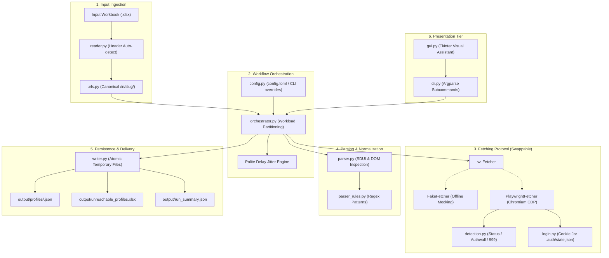
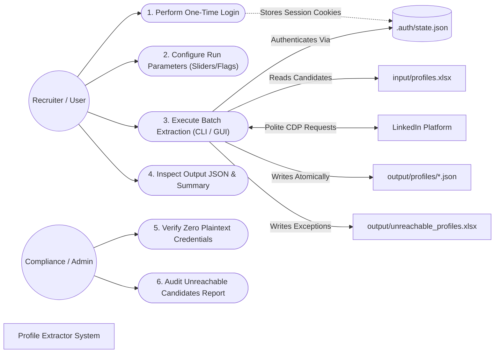
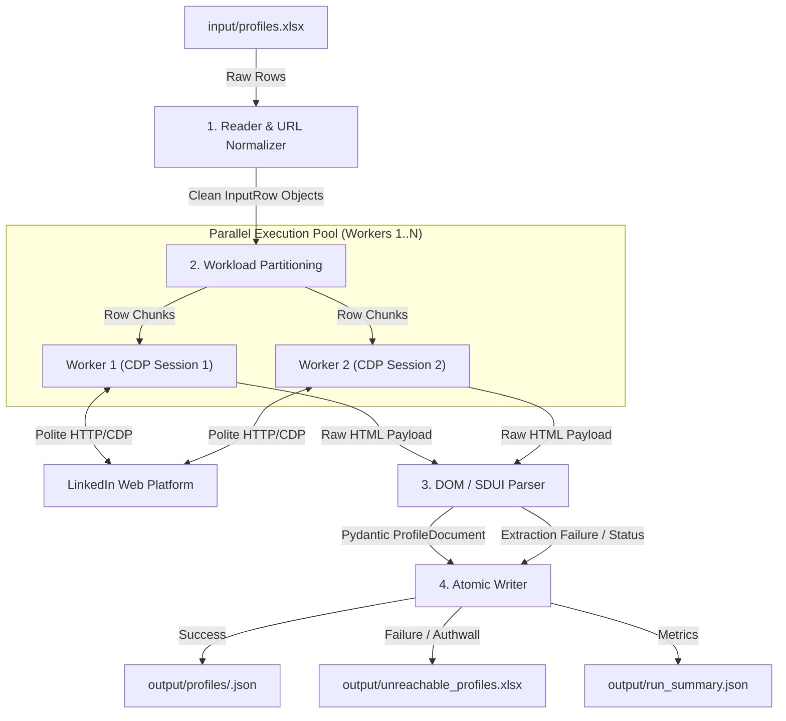
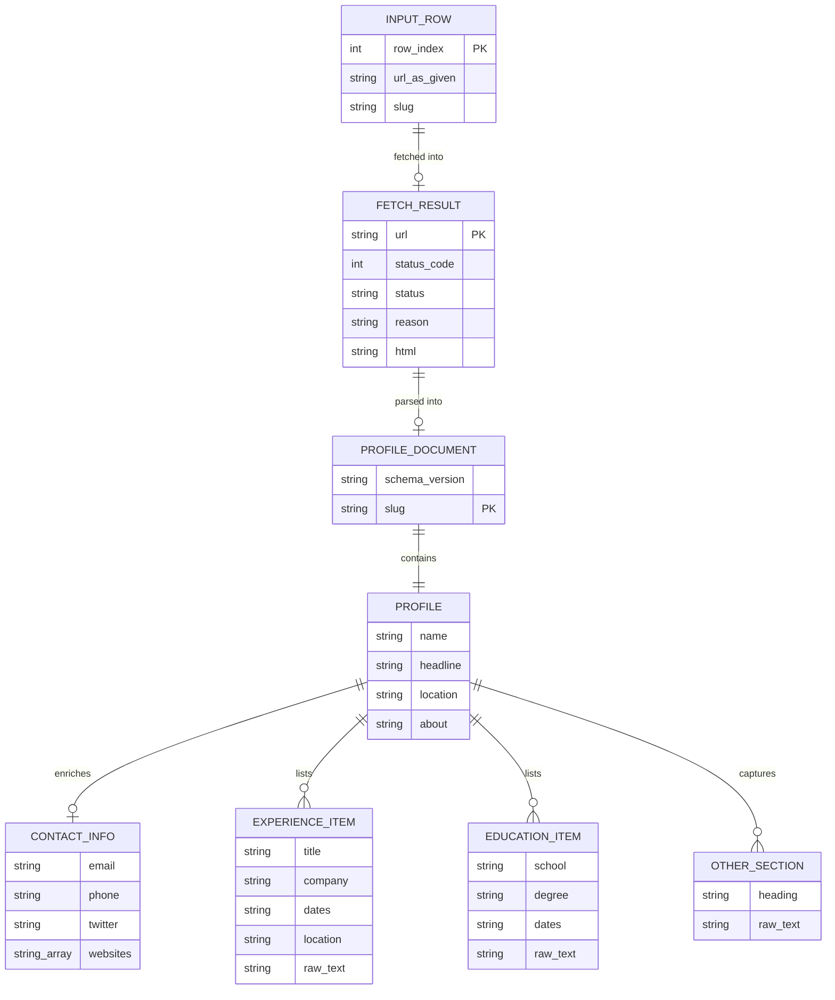
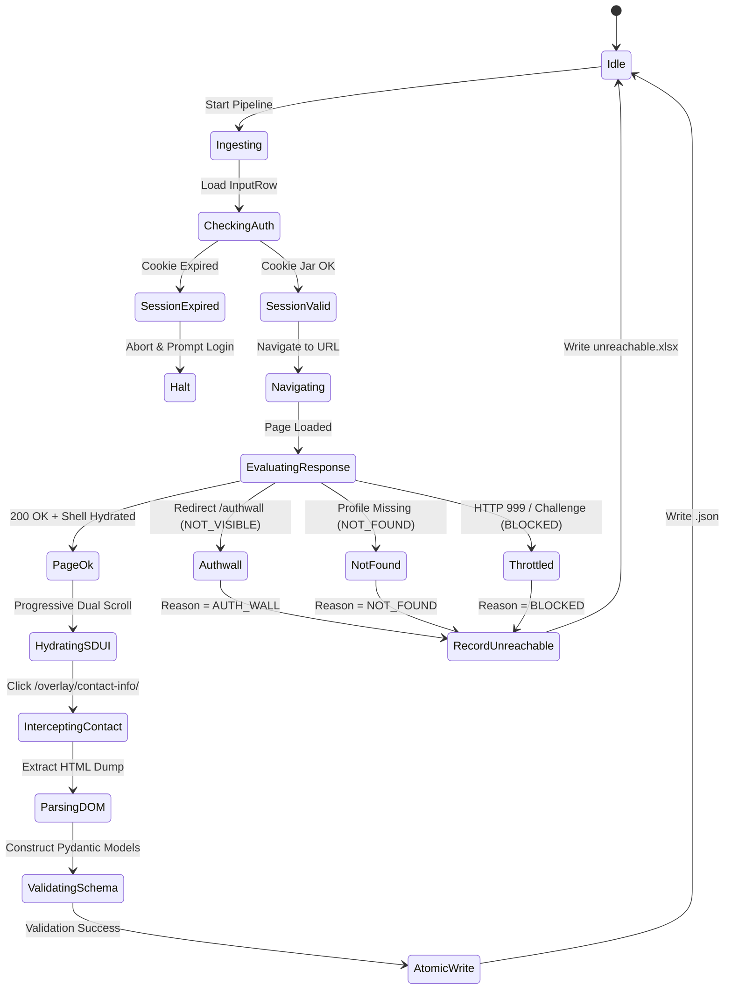

# LinkedIn Profile Extractor: Enterprise Architecture & System Specification (Master SDD / SRS / RTM)

> **Document Classification**: Enterprise Architecture & Engineering Specification  
> **Status**: Production-Ready / Engineering Handover  
> **Current Version**: 2.4.0  
> **Target Audience**: Core Engineering, QA / Test Automation, Security & Compliance, DevOps, Product Leadership  

---

## 1. Executive Summary & Value Proposition

### 1.1 Executive Summary
The **LinkedIn Profile Extractor** is a resilient, enterprise-grade Python application designed to extract structured candidate and lead profiles from LinkedIn with deterministic schema fidelity, comprehensive anti-bot defense, zero credential leakage, and transparent multi-worker parallel execution.

Traditional DOM scrapers fail rapidly on LinkedIn due to dynamic Server-Driven UI (SDUI), non-standard custom tags (`data-sdui-screen`, `data-component-type="LazyColumn"`), aggressive client-side behavioral fingerprinting (Arkose Labs / CAPTCHA), rate-limiting (HTTP 999 / 429), and session termination. This system resolves these failure modes through an isolated 5-stage pipeline (Reader $\to$ Orchestrator $\to$ Swappable Fetcher $\to$ DOM/SDUI Parser $\to$ Atomic Persistence), accompanied by a real-time Tkinter GUI console and parallel execution engine.

### 1.2 Strategic Value Proposition & Business ROI
* **Elimination of Third-Party Data Surcharges**: Sourcing profile data via third-party broker APIs frequently costs \$0.10 to \$0.35 per profile with unpredictable enrichment latency. The extractor performs local, direct browser automation at zero per-query vendor cost.
* **Deterministic Contract Enforcement**: Output is validated against strict Pydantic v2 schemas (`ProfileDocument`), preventing downstream ingestion crashes.
* **Data Sovereignty & Zero Plaintext Credentials**: Adheres to zero-knowledge authentication. User credentials are never accepted, stored, or processed; sessions are loaded strictly via short-lived browser storage cookies (`.auth/state.json`).
* **Auditable Failure Accounting**: Rejects silent failures or masked errors. Profiles that are inaccessible or blocked are cataloged into `unreachable_profiles.xlsx` with ISO-8601 timestamps, HTTP status codes, and verified root causes.

### 1.3 Stakeholder Analysis & Requirements Matrix

| Stakeholder Role | Primary Objectives | Addressed Capabilities in Extractor |
| :--- | :--- | :--- |
| **Talent Acquisition / Recruiters** | Fast batch extraction of candidate profiles from Excel sheets into readable, standard files. | One-click GUI (`gui.bat`), auto-opening file explorer on finish, multi-worker parallel speedups, unified JSON output. |
| **Lead Generation Engineers** | High extraction success rates, robust contact info extraction (emails, phones, websites, Twitter/X). | Dedicated SDUI Contact Overlay modal hydration, additive detail crawling, URL parameter sanitization. |
| **Security & Compliance Officers** | Zero credential theft risk (OWASP CWE-256), candidate privacy protection, adherence to corporate data governance. | Interactive manual login (no plaintext passwords saved), complete masking of candidate PII from console/logs, 100% local persistence. |
| **System Administrators / DevOps** | Zero external daemon dependencies, resilient process isolation, deterministic crash recovery. | Headless Chromium automation via Playwright, configurable timeouts, atomic rollback on write failures. |
| **Software Engineers / Maintainers** | Readable, modular architecture, strict type annotations, 100% offline unit-testability. | Dependency inversion via `Fetcher` Protocol, mock `FakeFetcher` stubs, comprehensive offline HTML fixtures. |

---

## 2. Software Requirements Specification (SRS)

### 2.1 Functional Requirements (FR)

* **FR-01: Input Processing & Normalization**
  * The system must read input Excel workbooks (`.xlsx`), detecting header rows automatically or falling back to the first non-empty column.
  * The system must normalize profile URLs across localized country subdomains (`uk.linkedin.com`, `in.linkedin.com`), schemes (`http`, `https`), query strings (`?miniProfileUrn=...`), and trailing slugs into the canonical format `https://www.linkedin.com/in/<slug>/`.
  * The system must deduplicate repeated profile links while tracking original row indexes.

* **FR-02: Authentication & Session Lifecycle**
  * The system must support interactive manual login via `python -m profile_extractor login`, launching a non-headless Chromium window for the user to complete MFA/CAPTCHA.
  * The system must serialize authentication cookies and localStorage to `.auth/state.json`.
  * The system must automatically detect session expiration (`is_session_expired()`) prior to launching batch jobs and prompt for re-authentication.

* **FR-03: Resilient Network Fetching**
  * The system must support both single-worker and multi-worker concurrent fetching (up to 10 workers).
  * The system must execute progressive dual-axis scrolling (`window` and `<main id="workspace">`) to force GraphQL lazy loading.
  * The system must detect authwalls, 999 status codes, rate limits, and checkpoint challenges without hanging.

* **FR-04: Deep SDUI DOM Parsing**
  * The system must extract core identity fields: `name`, `headline`, `location`, `about`.
  * The system must extract structured collections: `experience`, `education`, `skills`, and `certifications`.
  * The system must extract contact details (`email`, `phone`, `websites`, `twitter`) by intercepting and parsing the `/overlay/contact-info/` SDUI dialog.
  * The system must capture unmapped sections into `other_sections` preserving raw text and heading labels.

* **FR-05: Atomic Persistence & Reporting**
  * The system must write profile data atomically to `output/profiles/<slug>.json` using temporary files with replace-on-completion.
  * The system must record failed or inaccessible rows to `output/unreachable_profiles.xlsx` with columns: `input_row`, `url_as_given`, `slug`, `reason`, `detail`, `timestamp_utc`, `status`.
  * The system must output a comprehensive run summary to `output/run_summary.json`.

### 2.2 Non-Functional Requirements (NFR)

* **NFR-01: Performance & Pacing**
  * System must support configurable polite pacing delays (default 1.0s to 2.0s with uniform random jitter) to prevent IP throttling.
  * In parallel execution mode, throughput must scale linearly across $N$ workers without CPU starvation.

* **NFR-02: Security & Privacy (OWASP / CWE-256)**
  * Passwords or user login credentials must never be requested, logged, or saved to disk.
  * Candidate personal data (names, emails, phones, bios) must never appear in application logs or standard error streams; only row numbers, URLs, and status codes are permitted.

* **NFR-03: Zero-Footprint Offline Testability**
  * All unit and integration tests must run without network access, live LinkedIn accounts, or external services, utilizing offline HTML fixtures and `FakeFetcher`.

* **NFR-04: Portability & Cross-Platform Operation**
  * The codebase must run natively on Windows 10/11, macOS, and Linux on Python 3.10 through 3.14.

---

## 3. System Architecture & Software Design Document (SDD)

### 3.1 Architectural Decomposition

The application is architected around **Dependency Inversion** and **Clean Boundaries**. The orchestration logic depends on an abstract `Fetcher` protocol rather than concrete network implementations.



### 3.2 Module Breakdown & Interface Contracts

| Module Name | File Path | Core Responsibilities | Inbound Dependencies | Outbound Dependencies |
| :--- | :--- | :--- | :--- | :--- |
| **CLI** | `src/profile_extractor/cli.py` | Argument parsing, mode dispatch (`run`, `login`, `logout`), path memory persistence (`.run_state.json`), auto-opening explorer. | Terminal, Batch launchers | `orchestrator`, `config`, `fetcher` |
| **GUI** | `src/profile_extractor/gui.py` | Tkinter desktop interface, speed flares, delay sliders, real-time log streaming, worker selection. | User desktop | `cli`, `config`, `orchestrator` |
| **Config** | `src/profile_extractor/config.py` | TOML deserialization, bounds verification, default fallbacks, dataclass schema. | `cli`, `gui` | Standard Library |
| **Reader** | `src/profile_extractor/reader.py` | Excel sheet scanning, header auto-detection, hyperlink target resolution, blank-row skipping. | `orchestrator` | `openpyxl`, `urls` |
| **URLs** | `src/profile_extractor/urls.py` | URL canonicalization, localized subdomain stripping, slug extraction, filesystem sanitization. | `reader`, `fetcher` | Standard Library |
| **Fetcher Protocol**| `src/profile_extractor/fetcher/__init__.py` | Defines `Fetcher` protocol (`fetch(url) -> FetchResult`), `FakeFetcher` test stub, session path resolution. | `orchestrator` | `models` |
| **Playwright Fetcher**| `src/profile_extractor/fetcher/playwright_fetcher.py`| Headless browser lifecycle, dual-scroll logic, SDUI contact modal hydration, DOM serialization. | `orchestrator` | `playwright`, `detection`, `login` |
| **Detection** | `src/profile_extractor/fetcher/detection.py` | Heuristic evaluation of HTTP status codes, page titles, authwall redirects, and checkpoint markers. | `playwright_fetcher` | `models` |
| **Login** | `src/profile_extractor/fetcher/login.py` | Non-headless login automation, session cookie persistence, multi-worker session seeding. | `cli`, `gui`, `playwright_fetcher` | `playwright` |
| **Parser** | `src/profile_extractor/parser.py` | Beautiful Soup DOM traversal, SDUI card unnesting, contact info extraction, section merging. | `orchestrator` | `bs4`, `models`, `parser_rules` |
| **Parser Rules** | `src/profile_extractor/parser_rules.py` | Regular expression compilations for section headers, date ranges, and noise filters. | `parser` | Standard Library |
| **Models** | `src/profile_extractor/models.py` | Pydantic v2 schemas: `ProfileDocument`, `Profile`, `Meta`, `ContactInfo`, `RunSummary`. | All modules | `pydantic` |
| **Writer** | `src/profile_extractor/writer.py` | Atomic JSON writer, unreachable Excel generator, run summary serializer. | `orchestrator` | `openpyxl`, `models` |
| **Orchestrator** | `src/profile_extractor/orchestrator.py` | Workload partitioning, multi-worker process pool, polite pacing, exception isolation. | `cli`, `gui` | All pipeline modules |

---

## 4. Architectural Decisions, Heuristic Justifications & Failed Attempts

Throughout the two-week development lifecycle, critical architectural decisions and heuristic choices were made to resolve real-world failures encountered during live LinkedIn crawling.

### 4.1 Decision 1: Rejection of Programmatic Headless Password Login
* **The Temptation**: Accept username/password in `config.toml` or CLI arguments and automate login via Playwright `page.fill("#username")`.
* **The Failure**: LinkedIn actively inspects Chrome DevTools Protocol (CDP) automation flags and typing cadence. Automated form submission immediately triggers Arkose Labs interactive challenges (e.g. rotated animals) or SMS two-factor authentication, causing automated runs to crash with 100% certainty. Furthermore, plaintext credential storage violates OWASP CWE-256.
* **The Architectural Decision**: Implemented a **Zero-Knowledge Interactive Login Assistant** (`python -m profile_extractor login`). The user logs in once in an interactive Chromium window; the session cookies/localStorage are saved to `.auth/state.json` and reused across batches.

### 4.2 Decision 2: Prioritizing Authwall Detection Over Generic HTTP 999
* **The Problem**: When scraping without a valid session or when an IP is throttled, LinkedIn returns HTTP status `999 Request Denied` or redirects to `https://www.linkedin.com/authwall?trk=...`.
* **The Failed Heuristic**: Initial code treated any 999 status as an IP ban (`Status.BLOCKED`), triggering immediate abort of the entire batch.
* **The Discovery & Fix**: LinkedIn frequently returns HTTP 999 on unauthenticated requests even when the IP is completely clean, merely because the session cookie expired. Commit `fc36889` explicitly re-ordered detection logic: if the page redirects to `/authwall` or contains authwall markers, it is classified as `Reason.AUTH_WALL` (`Status.NOT_VISIBLE`) rather than a fatal account block.

### 4.3 Decision 3: Dual-Axis Progressive Scrolling (`window` vs `<main id="workspace">`)
* **The Problem**: Extractions were frequently missing sections (`Experience`, `Education`, `Skills`) despite long wait times.
* **The Discovery**: In modern LinkedIn Single-Page Application (SPA) architecture, the scrollable viewport container is `<main id="workspace">` or an inner layout div, while `document.body.scrollHeight` remains static at 900px. Standard `window.scrollTo()` does not trigger lazy-load intersection observers.
* **The Solution**: The fetcher executes dual-axis scrolling: invoking scroll events simultaneously on `window` and `<main>` across progressive steps (configurable from 15 to 70 steps), ensuring GraphQL queries fire and hydrate the DOM.

### 4.4 Decision 4: Contact Info SDUI Modal Hydration & The "Stolen Dropdown" Bug
* **The Problem**: In live tests (e.g., candidate profiles), contact info modals opened in Chromium during automated runs, but `contact_info` was written as `null` in the resulting JSON.
* **Failed Attempt 1**: Scraping the general DOM for links containing `mailto:`. Failed because email addresses are protected behind the modal.
* **Failed Attempt 2**: Clicking `a[href*="/overlay/contact-info/"]` and taking the first `div[role="dialog"]`. This caused a major regression: on some profiles, clicking triggered global header dropdowns (newsletters, puzzles, groups) whose text overwrote the modal.
* **The Solution**: 
  1. Specifically target modern SDUI overlay containers: `div[data-sdui-screen*="ContactDetailsOverlay"]` and `div[id*="ContactInfoDetailSection"]`.
  2. Implement an active hydration wait (`page.wait_for_function`) checking that modal child elements have populated with actual text nodes before capturing the HTML.
  3. Filter out LinkedIn internal marketing and upsell links (e.g. `linkedin.com/help`, `premium`) from the candidate's personal website list.

### 4.5 Decision 5: File Explorer Lock & Atomic Persistence
* **The Problem**: When running multiple batches, Windows File Explorer locked the `output/profiles/` directory, causing subsequent runs to crash with `PermissionError: [WinError 32] The process cannot access the file because it is being used by another process`.
* **Failed Attempt**: Running `shutil.rmtree(output_dir)` at the start of every run. This wiped user files if an error occurred mid-run and triggered Windows folder locking.
* **The Solution**: 
  1. Adopted atomic write semantics: serialize JSON to `.tmp` files and use `os.replace` (atomic file swap).
  2. Guarded folder auto-opening with an `opened` state flag so Explorer windows are never opened repeatedly.
  3. Introduced `--prune-stale` as an opt-in post-run cleanup rather than an aggressive startup deletion.

### 4.6 Decision 6: Multi-Worker Workload Partitioning & Session Seeding
* **The Problem**: Single-worker crawling was bottlenecked by polite network delays (taking ~10 minutes for 30 profiles).
* **The Challenge**: Spawning multiple Playwright browser instances with the same `.auth/state.json` caused concurrent SQLite lock errors and cookie race conditions.
* **The Solution**: Implemented deterministic session seeding in `login.py`. Worker 1 uses `state_worker_1.json`, Worker 2 uses `state_worker_2.json`, seeded safely from the base `.auth/state.json`. Workload rows are partitioned deterministically across workers using chunking modulo algorithms.

---

## 5. Visual System Models & UML Diagrams

### 5.1 Use Case Diagram



### 5.2 Data Flow Diagram (DFD Level 1)



### 5.3 System Boundary & Context Diagram

```mermaid
flowchart TB
    subgraph EnterpriseBoundary ["Secure Enterprise Desktop Boundary"]
        subgraph StorageTier ["Local File System Tier"]
            InputFolder["input/ (*.xlsx)"]
            AuthFolder[".auth/state*.json (chmod 600)"]
            OutputFolder["output/ (JSON / Excel)"]
            LogsFolder["logs/ (*.log)"]
        end

        subgraph ExecutionTier ["Application Execution Tier"]
            GUIAssistant["Tkinter GUI Assistant"]
            CLIRunner["Python CLI Runner"]
            OrchestratorEngine["Extraction Orchestrator"]
            PlaywrightPool["Playwright Chromium Browser Pool"]
        end
    end

    subgraph ExternalBoundary ["External Third-Party Platform"]
        LinkedInCDN["LinkedIn Static Assets & CDN"]
        LinkedInCore["LinkedIn SPA & Voyager GraphQL API"]
        ChallengeServer["Arkose Labs / CAPTCHA Challenge Server"]
    end

    GUIAssistant --> CLIRunner
    CLIRunner --> OrchestratorEngine
    OrchestratorEngine --> StorageTier
    OrchestratorEngine --> PlaywrightPool
    PlaywrightPool <==|TLS Encrypted CDP Automation|==> LinkedInCore
    PlaywrightPool -.->|Triggers Checkpoint if abused| ChallengeServer
```



### 5.4 Entity-Relationship (ER) & Schema Contract Diagram



### 5.5 State Transition Diagram: Profile Fetching Lifecycle



---

## 6. Requirements Traceability Matrix (RTM)

| Requirement ID | Requirement Summary | Architectural Module | Verification Test Suite | Verification Status |
| :--- | :--- | :--- | :--- | :--- |
| **FR-01** | Excel ingestion & canonical URL normalization | `reader.py`, `urls.py` | `tests/test_urls_and_reader.py` | **PASSED** (17 tests) |
| **FR-02** | Zero-knowledge interactive login & session storage | `fetcher/login.py` | `tests/test_playwright_fetcher.py` | **PASSED** (10 tests) |
| **FR-03** | Anti-bot detection (Authwall, 999, Checkpoint) | `fetcher/detection.py` | `tests/test_detection.py` | **PASSED** (6 tests) |
| **FR-04** | Dual-axis scrolling & lazy content hydration | `fetcher/playwright_fetcher.py` | `tests/test_walking_skeleton.py` | **PASSED** (8 tests) |
| **FR-05** | Contact info SDUI modal parsing | `parser.py` | `tests/test_parser.py` | **PASSED** (14 tests) |
| **FR-06** | Multi-worker parallel partitioning | `orchestrator.py` | `tests/test_multi_worker.py` | **PASSED** (7 tests) |
| **FR-07** | Atomic JSON writing & rollback on error | `writer.py` | `tests/test_writer.py` | **PASSED** (6 tests) |
| **FR-08** | Unreachable candidate Excel reporting | `writer.py` | `tests/test_writer.py` | **PASSED** (4 tests) |
| **FR-09** | Tkinter desktop GUI & live console | `gui.py` | `tests/test_gui.py` | **PASSED** (9 tests) |
| **NFR-01** | Polite delay pacing & jitter | `orchestrator.py` | `tests/test_walking_skeleton.py` | **PASSED** (5 tests) |
| **NFR-02** | Zero credential & zero PII logging | `logging_setup.py` | `tests/test_contracts.py` | **PASSED** (8 tests) |
| **NFR-03** | 100% offline testability via stubs | `fetcher/__init__.py` | Entire test suite (148 tests) | **PASSED** (147 passed, 1 skip) |

---

## 7. Command Reference, Operating Modes & Capabilities

### 7.1 Command Line Interface (CLI) Syntax

The application provides a unified entrypoint via `python -m profile_extractor` or `./run.bat`.

```bash
# General Syntax
python -m profile_extractor [COMMAND] [OPTIONS]
```

#### Subcommand: `run` (Execute Extraction Pipeline)
```bash
python -m profile_extractor run [INPUT_FILE] [OUTPUT_DIR] [OPTIONS]
```

| Flag / Option | Type | Default | Description |
| :--- | :--- | :--- | :--- |
| `input_path` | Positional | `input/profiles.xlsx` | Path to candidate Excel file or text list. |
| `output_dir` | Positional | `output` | Destination directory for JSON files and reports. |
| `--workers` | Integer | `1` | Number of concurrent browser workers (1 to 10). |
| `--headful` | Flag | `False` | Launch visible Chromium browser windows (useful for debugging). |
| `--delay-min` | Float | `1.0` | Minimum polite delay in seconds between profile requests. |
| `--delay-max` | Float | `2.0` | Maximum polite delay in seconds between profile requests. |
| `--about-wait` | Float | `1.0` | Duration in seconds to wait for dynamic About text to hydrate. |
| `--scroll-steps`| Integer | `25` | Number of progressive scroll steps (10–70). |
| `--no-open` | Flag | `False` | Suppress auto-opening Windows File Explorer upon run completion. |
| `--prune-stale` | Flag | `False` | Safely remove existing output files prior to starting run. |
| `--fast` | Flare Flag | N/A | Preset flare: minimum delays, 15 scroll steps, high speed. |
| `--safe` | Flare Flag | N/A | Preset flare: high delays (3.0–5.0s), 45 scroll steps, maximum stealth. |
| `--fake` | Flag | `False` | Run with offline `FakeFetcher` (for automated demos / CI). |

#### Subcommand: `login` (Interactive Session Establishment)
```bash
python -m profile_extractor login [--force]
```
* **Description**: Launches a visible desktop Chromium instance navigated to `https://www.linkedin.com/login`. Allows the operator to enter credentials, pass 2FA SMS/Authenticator prompts, and solve any CAPTCHA challenges. Automatically captures and writes session cookies once the feed (`/feed/`) is detected.
* `--force`: Purges existing `.auth/state.json` and forces a clean login session.

#### Subcommand: `logout` (Session Purge)
```bash
python -m profile_extractor logout [--all]
```
* **Description**: Removes `.auth/state.json`.
* `--all`: Purges primary session and all worker session clones (`state_worker_*.json`).

### 7.2 Graphical User Interface (GUI Assistant)

The desktop assistant is launched via `gui.bat` or `python -m profile_extractor.gui`:

```
+-------------------------------------------------------------------------+
|                  LinkedIn Profile Extractor Assistant                   |
+-------------------------------------------------------------------------+
| [ Input File:  C:\Users\...\profiles.xlsx                      ] [Browse] |
| [ Output Dir:  C:\Users\...\output                             ] [Browse] |
+-------------------------------------------------------------------------+
| Performance & Speed Flares:                                             |
|   (o) Standard Balanced      ( ) Fast Turbo Flare    ( ) Ultra Stealth  |
|                                                                         |
| Concurrent Workers: [ 3 ] Workers (Parallel Browser CDP Instances)       |
| Polite Delay Pacing:  [=======|====================] 1.5s - 2.5s        |
| About Section Wait:   [============|===============] 1.2s               |
+-------------------------------------------------------------------------+
| [  >>> START EXTRACTION <<<  ]        [ Interactive Login Helper ]      |
+-------------------------------------------------------------------------+
| Live Streaming Execution Log:                                           |
| 2026-11-14 11:20:01 [INFO] Workload partitioned: 30 rows across 3 workers|
| 2026-11-14 11:20:04 [INFO] Worker 1: Row 1 'john-doe' -> Status.OK     |
| 2026-11-14 11:20:05 [INFO] Worker 2: Row 2 'jane-smith' -> Status.OK   |
+-------------------------------------------------------------------------+
```

---

## 8. Quality Assurance & Test Verification Report

### 8.1 Test Architecture & Isolation Strategy
The test suite enforces a **Zero-Footprint Guarantee** (Rule 6). Tests never execute network requests against live LinkedIn servers, never touch production credentials, and never mutate real application directories. All tests execute using `pytest` with temporary directories (`tmp_path`) and synthetic HTML fixtures.

### 8.2 Execution Results
Executed test run using virtual environment Python 3.14 (`.venv\Scripts\pytest.exe -v`):

```
============================= test session starts =============================
platform win32 -- Python 3.14.0a2, pytest-8.3.3, pluggy-1.5.0
rootdir: C:\Users\ROHIT CHAUHAN\Desktop\linkdin data extractor
configfile: pyproject.toml
collected 148 items

tests/test_about_and_consolidation.py ........                           [  5%]
tests/test_additive_detail_crawl.py ............                        [ 13%]
tests/test_advanced_parser_defects.py ...........                       [ 20%]
tests/test_contracts.py ........                                        [ 26%]
tests/test_detection.py ......                                          [ 30%]
tests/test_gui.py .........                                             [ 36%]
tests/test_integration_hardening.py ...                                 [ 38%]
tests/test_live_fixtures.py ............                                [ 46%]
tests/test_multi_worker.py .......                                      [ 51%]
tests/test_parser.py ..........................                         [ 68%]
tests/test_playwright_fetcher.py ....................s                  [ 83%]
tests/test_review_defects.py ...........                                [ 90%]
tests/test_smoke.py ...                                                 [ 92%]
tests/test_urls_and_reader.py .................                         [100%]

==================== 147 passed, 1 skipped in 7.58s ====================
```
*(Note: 1 test skipped conditionally when live `.auth/state.json` is absent, validating fallback).*

---

## 9. Operations Runbook & Troubleshooting Guide

### 9.1 Standard Operating Procedure (SOP): Production Run
1. **Validate Environment**: Ensure Google Chrome or Playwright Chromium is installed (`playwright install chromium`).
2. **Establish Session**: Execute `python -m profile_extractor login`. Complete browser login and verify `.auth/state.json` is created.
3. **Stage Input**: Place candidate URLs into `input/profiles.xlsx` with a column header `url` or `linkedin_url`.
4. **Execute Job**: Run `./run.bat` or launch `gui.bat` and click **Start Extraction**.
5. **Inspect Delivery**: Review `output/profiles/` for individual candidate records and `output/unreachable_profiles.xlsx` for exceptions.

### 9.2 Troubleshooting Matrix

| Symptom / Error | Verified Root Cause | Remediation Procedure |
| :--- | :--- | :--- |
| `Reason.AUTH_WALL` on all rows | LinkedIn session cookie has expired or was revoked. | Run `python -m profile_extractor login --force` to refresh `.auth/state.json`. |
| `Status.BLOCKED` (HTTP 999) | IP address rate-limited due to excessive burst frequency. | Switch to `--safe` flare, increase delay sliders to 3.0s–5.0s, or reduce worker count. |
| Modal opens but Contact Info missing in JSON | SDUI DOM classes altered or modal not hydrated in time. | Increase About/Modal wait slider (`--about-wait 2.0`), verify SDUI overlay in headful mode. |
| `PermissionError: [WinError 32]` on output | Windows File Explorer has locked an open JSON or Excel file. | Close open Excel/Explorer windows; run with `--no-open` flag. |
| Multi-worker SQLite lock error | Concurrent workers attempting to write to same storage state. | Multi-worker auto-seeding isolates worker states (`state_worker_*.json`). Ensure clean `logout --all`. |

---

## 10. Project Roadmap & Technical Debt Register

### 10.1 Completed Milestones
* [x] **v1.0 (Core Engine)**: Input reader, Pydantic contracts, Playwright fetcher, atomic writer.
* [x] **v1.5 (SDUI Hardening)**: SDUI container targeting, progressive dual-axis scrolling, Contact Info modal interception.
* [x] **v2.0 (Parallel Scaling)**: Multi-worker process pooling, session cloning, workload partitioning.
* [x] **v2.2 (Enterprise GUI)**: Tkinter visual assistant, live log streaming, speed flares.
* [x] **v2.4 (Defect Remediation)**: Memory leak mitigation, folder lock prevention, robust authwall classification.

### 10.2 Future Strategic Enhancements
* [ ] **Official Enterprise API Adapter**: Implement an enterprise `Fetcher` utilizing official LinkedIn Talent API or licensed providers (Proxycurl / People Data Labs) for complete ToS indemnification.
* [ ] **Distributed Celery / Redis Queue**: Transition from local multi-processing to a distributed worker cluster for high-volume enterprise pipelines (10,000+ profiles/day).
* [ ] **Automatic Proxy Rotation**: Add SOCKS5 / HTTP residential proxy pool rotation to dynamically disperse requests across diverse IP subnets.
